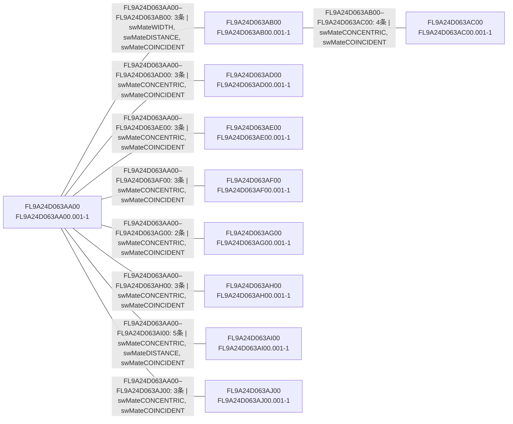

# 项目03模组级配合图审计

- Schema：`solidworks-module-mate-graph/v1.2`
- 原型：`D:\zengshuang\workspace\cuhksz\cad_data\001-给港中文AI训练用资料_20260624\项目03\01-项目3D图纸\FL9A24D063A000.001-0415\FL9A24D063A000.001.SLDASM`
- 已识别模组实例：10
- 跨模组配合：29
- 配合束：9
- 忽略的模组内部配合：13
- 未解析/多端模组配合：4

> 本图表达原型中的无向设计关系，不直接等价于机械装配顺序。

## 模组关系图

## 配合束明细

| 模组对 | 配合数 | 可重建基础面配合 | 类型 | 初步判断 |
|---|---:|---:|---|---|
| FL9A24D063AA00–FL9A24D063AB00 | 3 | 2 | swMateWIDTH, swMateDISTANCE, swMateCOINCIDENT | `POSITION_AND_ORIENTATION_BUNDLE_CANDIDATE` |
| FL9A24D063AA00–FL9A24D063AD00 | 3 | 3 | swMateCONCENTRIC, swMateCOINCIDENT | `ORIENTATION_OR_CONTACT_ONLY_PARTIAL_RELATION` |
| FL9A24D063AA00–FL9A24D063AE00 | 3 | 3 | swMateCONCENTRIC, swMateCOINCIDENT | `ORIENTATION_OR_CONTACT_ONLY_PARTIAL_RELATION` |
| FL9A24D063AA00–FL9A24D063AF00 | 3 | 2 | swMateCONCENTRIC, swMateCOINCIDENT | `ORIENTATION_OR_CONTACT_ONLY_PARTIAL_RELATION` |
| FL9A24D063AA00–FL9A24D063AG00 | 2 | 2 | swMateCONCENTRIC, swMateCOINCIDENT | `ORIENTATION_OR_CONTACT_ONLY_PARTIAL_RELATION` |
| FL9A24D063AA00–FL9A24D063AH00 | 3 | 3 | swMateCONCENTRIC, swMateCOINCIDENT | `ORIENTATION_OR_CONTACT_ONLY_PARTIAL_RELATION` |
| FL9A24D063AA00–FL9A24D063AI00 | 5 | 5 | swMateCONCENTRIC, swMateDISTANCE, swMateCOINCIDENT | `POSITION_AND_ORIENTATION_BUNDLE_CANDIDATE` |
| FL9A24D063AA00–FL9A24D063AJ00 | 3 | 3 | swMateCONCENTRIC, swMateCOINCIDENT | `ORIENTATION_OR_CONTACT_ONLY_PARTIAL_RELATION` |
| FL9A24D063AB00–FL9A24D063AC00 | 4 | 4 | swMateCONCENTRIC, swMateCOINCIDENT | `ORIENTATION_OR_CONTACT_ONLY_PARTIAL_RELATION` |

## 诊断

- Built one-pass component identity index for 2135 instances from 2140 assembly components.
- Mate edges are undirected design relations; assembly precedence must be supplied or inferred separately.

## 人工复核重点

1. A600–A800是否存在完整的位置与方向配合束；
2. A180是否通过直接或中间安装件与A600/A800建立关系；
3. A500、A700、A300位于操作面侧或对侧的关系能否从图中观察；
4. A100与A800及功能模组的关系是直接装配关系，还是仅由最终位姿体现；
5. 配合图中缺失的扫描视场、工作位、服务点和点胶行程仍需语义标注。
